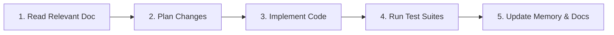

# AGENTS.md — AI Agent Guidelines & Repository Manual

## 1. Project Summary
The **Professional-Level Cloud Web Application** is a decoupled full-stack Notes system engineered for high availability on AWS. It features a static Single Page Application frontend (React + Vite) intended for Amazon S3 and CloudFront CDN, an asynchronous REST API (FastAPI) designed for an EC2 Auto Scaling Group behind an Application Load Balancer inside a private VPC, and a relational data tier (Amazon RDS PostgreSQL). For complete architectural topology, pre-compiled system state, and master codebase map, refer directly to [BRAIN.md](file:///e:/PROJECTS/Professional-Level%20Cloud%20Web%20Application/BRAIN.md), [README.md](file:///e:/PROJECTS/Professional-Level%20Cloud%20Web%20Application/README.md) and [docs/ARCHITECTURE.md](file:///e:/PROJECTS/Professional-Level%20Cloud%20Web%20Application/docs/ARCHITECTURE.md).

---

## 2. Documentation Matrix: What to Read Before Tasks

| Task Type | Primary Document to Read First | Key Details to Check |
|---|---|---|
| Complete codebase map, schemas, contracts & mental model | [BRAIN.md](file:///e:/PROJECTS/Professional-Level%20Cloud%20Web%20Application/BRAIN.md) | Master pre-compiled index, endpoint matrix, all file roles, commands |
| Cloud infra, VPC, ALB, ASG, or deployment | [docs/ARCHITECTURE.md](file:///e:/PROJECTS/Professional-Level%20Cloud%20Web%20Application/docs/ARCHITECTURE.md), [docs/STEP1_RUNBOOK.md](file:///e:/PROJECTS/Professional-Level%20Cloud%20Web%20Application/docs/STEP1_RUNBOOK.md), [docs/STEP2_RUNBOOK.md](file:///e:/PROJECTS/Professional-Level%20Cloud%20Web%20Application/docs/STEP2_RUNBOOK.md) | Subnet CIDRs, Security Group chains, console runbooks, costs |
| Requirements, features, roadmap, phases | [docs/PRD.md](file:///e:/PROJECTS/Professional-Level%20Cloud%20Web%20Application/docs/PRD.md), [docs/PHASES.md](file:///e:/PROJECTS/Professional-Level%20Cloud%20Web%20Application/docs/PHASES.md) | User stories, acceptance criteria, phase gates |
| Engineering rules, UI tokens, state memory | [docs/RULES.md](file:///e:/PROJECTS/Professional-Level%20Cloud%20Web%20Application/docs/RULES.md), [docs/DESIGN.md](file:///e:/PROJECTS/Professional-Level%20Cloud%20Web%20Application/docs/DESIGN.md), [docs/MEMORY.md](file:///e:/PROJECTS/Professional-Level%20Cloud%20Web%20Application/docs/MEMORY.md) | Prohibitions, color tokens, living context tracker |
| Database schema, indexes, migrations, backups | [docs/DATABASE.md](file:///e:/PROJECTS/Professional-Level%20Cloud%20Web%20Application/docs/DATABASE.md) | PostgreSQL data types, query indexes, PITR recovery, no RLS |
| Security reviews, credentials, CORS, OWASP | [docs/SECURITY.md](file:///e:/PROJECTS/Professional-Level%20Cloud%20Web%20Application/docs/SECURITY.md) | Secrets Manager, WAF rate limits, pre-merge checklist |
| Writing tests, verifying health, chaos proofs | [docs/TESTING.md](file:///e:/PROJECTS/Professional-Level%20Cloud%20Web%20Application/docs/TESTING.md) | Test pyramid, `/health` independence, instance kill proofs |
| Project onboarding and local setup | [README.md](file:///e:/PROJECTS/Professional-Level%20Cloud%20Web%20Application/README.md) | Docker Compose port mappings, run instructions, API specs |

---

## 3. Exact Execution Commands

### Local Infrastructure
```powershell
docker compose up -d    # Starts local PostgreSQL 16 on port 5433 (127.0.0.1)
docker compose down     # Stops local PostgreSQL container
```

### Backend (`backend/`)
```powershell
.\venv\Scripts\pip install -r requirements.txt   # Install dependencies
.\venv\Scripts\python run.py                     # Run API server on http://localhost:8000
.\venv\Scripts\pytest -v                         # Run backend test suite
.\venv\Scripts\pip install flake8; .\venv\Scripts\flake8 app tests # Lint backend code
```

### Frontend (`frontend/`)
```powershell
npm install        # Install dependencies
npm run dev        # Run Vite dev server on http://localhost:5173
npm test           # Run native Node unit tests
npm run build      # Compile production static bundle into dist/ (S3 target)
```

---

## 4. Hard Rules & Policy Enforcement

All detailed coding standards, prohibitions, and architectural boundaries are defined in [docs/RULES.md](file:///e:/PROJECTS/Professional-Level%20Cloud%20Web%20Application/docs/RULES.md), and security/cryptographic guidelines are defined in [docs/SECURITY.md](file:///e:/PROJECTS/Professional-Level%20Cloud%20Web%20Application/docs/SECURITY.md). Agents must follow them without departure:

1. **No Cloud or Terraform Actions:** Never run cloud CLI commands (`aws`, `az`, `gcloud`) or `terraform apply`/`destroy` without explicit user instruction.
2. **Never Commit Secrets:** Never hardcode or commit `.env` files, passwords, or credentials. Use `.env.example`.
3. **Ask Before Adding Tools:** Do not install unapproved packages, libraries, or external services without user consent.
4. **Strict Health Probe Decoupling:** Keep `GET /health` independent of the database; reserve database checks for `GET /health/db`.
5. **Preserve Decoupled Tier Architecture:** Frontend must compile to pure static assets for S3; backend must remain a stateless API.
6. **Session Handoff & Memory Protocol:** At the end of every session, update [docs/MEMORY.md](file:///e:/PROJECTS/Professional-Level%20Cloud%20Web%20Application/docs/MEMORY.md) with what was done, what is next, and open issues. Never write secrets, account IDs or IPs in it.

---

## 5. 5-Step Agent Development Workflow



1. **Read Relevant Documentation:** Review matching document in `docs/` before editing code or configuration.
2. **Formulate a Minimal Plan:** Design changes that adhere to existing architecture, schemas, and security boundaries.
3. **Implement Changes:** Write clean, modular code with strict input validation and appropriate error handling.
4. **Execute Tests:** Run both `backend` (`pytest`) and `frontend` (`npm test` and `npm run build`) to ensure zero regressions.
5. **Update Memory & Docs:** Verify definition-of-done, update docs, and record session state in [docs/MEMORY.md](file:///e:/PROJECTS/Professional-Level%20Cloud%20Web%20Application/docs/MEMORY.md).
