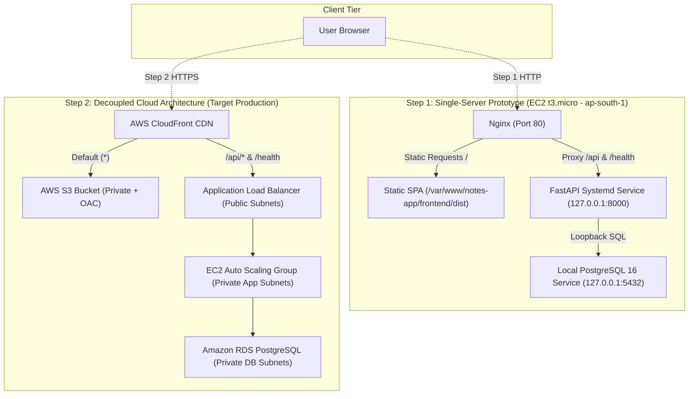

# BRAIN.md — Master Codebase Intelligence & Architectural Memory

> **Purpose for AI Agents & Developers:**  
> Read this single document first. It provides an exhaustive, pre-compiled distillation of the entire repository—architecture, file responsibilities, database schemas, API contracts, execution commands, security invariants, deployment scripts, and roadmap state—**eliminating the need to repeatedly scan the workspace.**

---

## ⚡ Quick Status Dashboard

| Attribute | State / Value | Notes |
|---|---|---|
| **Project Name** | Cloud Notes (Professional-Level Cloud Web App) | Decoupled 3-Tier Architecture |
| **Current Phase** | **Step 1 Ready for Console Provisioning** | Prep Phase: DONE; Step 1: Audited & Ready; Step 2: Documented |
| **Backend Stack** | FastAPI 0.110+ \| Python 3.11+ \| SQLAlchemy 2.0 \| Psycopg 3 | Stateless async REST API |
| **Frontend Stack** | React 18.3+ \| Vite 5.2+ \| Modular CSS3 | Pure static SPA bundle in `frontend/dist/` |
| **Database** | PostgreSQL 16 (Local Docker Compose \| RDS `db.t3.micro`) | Relational ACID, Alembic migrations |
| **Local Ports** | Frontend: `5173` \| API: `127.0.0.1:8000` \| DB: `127.0.0.1:5433` | Host DB collision safe (mapped `5433:5432`) |
| **Target AWS Region**| **Asia Pacific (Mumbai) `ap-south-1`** | Single-AZ learning budget |
| **Test Pass Rate** | **100% Pass** (11 Backend `pytest` + 2 Frontend `node:test`) | In-memory SQLite test isolation |

---

## 🏛️ System Architecture & Execution Tiers



### Dual Health Probe Strategy
1. **Shallow Health (`GET /health`):**
   - **Contract:** Returns HTTP 200 with `{"status":"healthy","service":"notes-api","timestamp":"..."}`.
   - **Critical Invariant:** Must **never** query the database or import database sessions. Used by ALB / Nginx to determine if the web process is alive without cascading failures during database load spikes.
2. **Deep Health (`GET /health/db`):**
   - **Contract:** Executes `SELECT 1` on PostgreSQL.
   - Returns HTTP 200 with `{"status":"healthy","database":"connected","timestamp":"..."}` on success.
   - Returns HTTP 503 with generic error `{"status":"unhealthy","database":"disconnected","error":"Database connectivity check failed"}` on failure (never leaks raw DB tracebacks).

---

## 🗺️ Complete Codebase Map & File Responsibilities

```text
e:/PROJECTS/Professional-Level Cloud Web Application/
├── BRAIN.md                          <-- (This file) Pre-compiled master index & mental model
├── README.md                         <-- Onboarding guide, 3-tier layout, local run steps
├── AGENTS.md                         <-- AI Agent operational manual, doc matrix, workflow
├── docker-compose.yml                <-- Local PostgreSQL 16 Alpine container (127.0.0.1:5433:5432)
├── .env.example                      <-- Sanitized template for environment variables
├── .gitignore                        <-- Ignores secrets, *.pem, *.key, deploy.zip, venv, dist, node_modules
│
├── backend/                          <-- Stateless FastAPI REST API Tier
│   ├── run.py                        <-- Entrypoint script for local development (uvicorn)
│   ├── requirements.txt              <-- Python 3.11 dependencies (FastAPI, SQLAlchemy, Psycopg, Alembic)
│   ├── alembic.ini                   <-- Alembic migration configuration
│   ├── alembic/                      <-- Database migrations package
│   │   ├── env.py                    <-- Alembic runtime environment (reads app.config.settings)
│   │   ├── script.py.mako            <-- Migration script template
│   │   └── versions/
│   │       └── 001_initial_notes_table.py <-- Migration: creates 'notes' table & ix_notes_title
│   ├── app/
│   │   ├── __init__.py               <-- Package marker (version = "1.0.0")
│   │   ├── config.py                 <-- Pydantic BaseSettings: DATABASE_URL, HOST, PORT, CORS_ORIGINS
│   │   ├── database.py               <-- SQLAlchemy engine, SessionLocal, get_db(), init_db()
│   │   ├── models.py                 <-- SQLAlchemy ORM model: Note
│   │   ├── schemas.py                <-- Pydantic v2 schemas: NoteCreate, NoteUpdate, NoteResponse
│   │   ├── main.py                   <-- FastAPI app factory, CORS, Security Headers, lifespan
│   │   └── routes/
│   │       ├── __init__.py           <-- Routes package marker
│   │       ├── health.py             <-- /health (shallow) and /health/db (deep) probe endpoints
│   │       └── notes.py              <-- CRUD endpoints (/api/notes: create, list, get, update, delete)
│   └── tests/
│       ├── __init__.py               <-- Test package marker
│       ├── conftest.py               <-- Pytest fixtures: in-memory SQLite isolation (no network DB)
│       ├── test_api.py               <-- 10 integration tests: health, CRUD, validation, bounds, security
│       └── test_example_health.py    <-- Example shallow health test fixture
│
├── frontend/                         <-- Static Single Page Application Tier (S3 / Nginx target)
│   ├── package.json                  <-- Node package config (React 18, Vite 5, native node:test)
│   ├── vite.config.js                <-- Vite config with dev proxy (/api & /health -> localhost:8000)
│   ├── index.html                    <-- HTML5 entrypoint document
│   ├── src/
│   │   ├── main.jsx                  <-- React DOM client mount
│   │   ├── App.jsx                   <-- Core UI: responsive note grid, create/edit modal, live health badges
│   │   ├── App.css                   <-- Component CSS: cards, forms, modal geometry, badges
│   │   ├── index.css                 <-- Global CSS variables & dark-theme design tokens
│   │   ├── api.js                    <-- Fetch wrapper with relative endpoints (/api/notes, /health)
│   │   └── api.test.js               <-- Native Node unit tests: URL building & payload dispatching
│   └── dist/                         <-- Compiled static bundle generated by 'npm run build' (ignored in git)
│
├── deploy/                           <-- Deployment & Server Provisioning Scripts
│   ├── user-data.sh                  <-- Step 2: EC2 Launch Template user-data bootstrap (SSM credentials)
│   └── step1/                        <-- Step 1: Single-server co-located deployment
│       ├── setup-server.sh           <-- Automated AL2023 bootstrap (Nginx, PG16, Alembic, systemd)
│       ├── nginx.conf                <-- Nginx proxy config: static frontend + /api & /health reverse proxy
│       ├── api.service               <-- Systemd unit file for FastAPI daemon (127.0.0.1:8000)
│       └── build-and-package.ps1     <-- Windows PowerShell script: builds frontend, creates deploy.zip
│
└── docs/                             <-- Architecture, Runbooks & Engineering Documentation
    ├── PRD.md                        <-- Product Requirements Document (features, local targets)
    ├── ARCHITECTURE.md               <-- Target cloud architecture, request flows, learning budget costs
    ├── RULES.md                      <-- Hard engineering rules, security standards, prohibitions
    ├── DESIGN.md                     <-- Design system tokens, color palettes, component specs
    ├── DATABASE.md                   <-- PostgreSQL schema, query indexes, backup & migration plans
    ├── SECURITY.md                   <-- OWASP checklist, data classification, network security, audit log
    ├── TESTING.md                    <-- Test pyramid commands, definition of done, 3 chaos proofs
    ├── PHASES.md                     <-- Project execution roadmap: Prep -> Step 1 -> Step 2 -> Step 3
    ├── MEMORY.md                     <-- Living context tracker, completed milestones, session memory
    ├── STEP1_RUNBOOK.md              <-- Click-by-click AWS Console guide for Step 1 single-server EC2
    └── STEP2_RUNBOOK.md              <-- Click-by-click AWS Console guide for Step 2 production cloud
```

---

## 🗄️ Database Schema & Data Models

### Table: `notes`

| Column | PostgreSQL Type | Python / Pydantic Type | Constraints | Purpose / Serving Query |
|---|---|---|---|---|
| `id` | `INTEGER` | `int` | Primary Key, Autoincrement | Unique note identifier |
| `title` | `VARCHAR(255)` | `str` (1–255 chars) | `NOT NULL`, Indexed (`ix_notes_title`) | Note heading, searched via `ILIKE` |
| `content` | `TEXT` | `str` (0–50,000 chars)| `NOT NULL` | Note body text |
| `created_at` | `TIMESTAMP WITH TIME ZONE` | `datetime` | `NOT NULL`, Default `NOW()` | Audit creation timestamp |
| `updated_at` | `TIMESTAMP WITH TIME ZONE` | `datetime` | `NOT NULL`, Default `NOW()` | Sort order: `order_by(Note.updated_at.desc())` |

### Database Indexes
- **`ix_notes_title` (B-tree on `notes.title`):** Serves prefix/exact title searches and equality filtering.
- **`pk_notes` (B-tree on `notes.id`):** Serves `GET /api/notes/{id}`, `PUT /api/notes/{id}`, `DELETE /api/notes/{id}`.

### Alembic Migration History
- **`001_initial` (`001_initial_notes_table.py`):** Creates table `notes` and index `ix_notes_title`. Run via `alembic upgrade head`.

---

## 🔌 API Endpoint Specifications

All endpoints serve JSON and return defensive security headers (`X-Content-Type-Options: nosniff`, `X-Frame-Options: DENY`, `X-XSS-Protection: 1; mode=block`, `Referrer-Policy: strict-origin-when-cross-origin`).

| Method | Endpoint | Query / Body Params | Status Code | Response Payload | Description |
|---|---|---|---|---|---|
| **GET** | `/` | None | `200 OK` | `{"status":"online","service":"Notes API"}` | Root API banner |
| **GET** | `/health` | None | `200 OK` | `{"status":"healthy","service":"notes-api","timestamp":"<ISO>"}` | Shallow health probe (ALB / Nginx) |
| **GET** | `/health/db` | None | `200 OK` / `503 Service Unavailable` | `{"status":"healthy","database":"connected","timestamp":"<ISO>"}` | Deep database connectivity probe |
| **GET** | `/api/notes` | `q` (Optional string, $\le 100$ chars) | `200 OK` | `List[NoteResponse]` | Lists notes ordered by `updated_at DESC`. Filters by title/content if `q` provided. |
| **POST** | `/api/notes` | `NoteCreate`: `{"title": str, "content": str}` | `201 Created` / `422 Unprocessable` | `NoteResponse` | Creates note. `title`: 1–255 chars; `content`: $\le 50,000$ chars. |
| **GET** | `/api/notes/{id}` | Path param `id: int` | `200 OK` / `404 Not Found` | `NoteResponse` | Fetches single note by ID. |
| **PUT** | `/api/notes/{id}` | Path `id: int`, Body `NoteUpdate`: `{"title"?: str, "content"?: str}` | `200 OK` / `404 Not Found` / `422` | `NoteResponse` | Updates existing note and sets `updated_at = NOW()`. |
| **DELETE**| `/api/notes/{id}`| Path param `id: int` | `204 No Content` / `404 Not Found` | Empty Body | Deletes note permanently. |

---

## 🌐 Network & Port Matrix Across Environments

| Environment | Component | Host / IP Binding | Port | Security / Access Scope |
|---|---|---|---|---|
| **Local Dev** | Frontend Dev Server | `localhost` | `5173` | Browser interface; Vite proxies `/api` & `/health` |
| **Local Dev** | Backend FastAPI | `127.0.0.1` | `8000` | Loopback only |
| **Local Dev** | Docker PostgreSQL | `127.0.0.1` | `5433:5432` | Loopback only (Docker Compose) |
| **Step 1 (EC2)** | Nginx Reverse Proxy | `0.0.0.0` | `80` | Publicly reachable (`0.0.0.0/0`) |
| **Step 1 (EC2)** | SSH Daemon | `0.0.0.0` | `22` | Restricted strictly to **Operator's IP (`x.x.x.x/32`)** |
| **Step 1 (EC2)** | FastAPI Backend | `127.0.0.1` | `8000` | Local loopback only (never exposed externally) |
| **Step 1 (EC2)** | PostgreSQL 16 | `127.0.0.1` | `5432` | Local loopback only (`listen_addresses = '127.0.0.1'`) |
| **Step 2 (Cloud)**| CloudFront CDN | Public Edge | `443` (HTTPS) | Global edge; forces HTTPS redirect |
| **Step 2 (Cloud)**| S3 Frontend | AWS Private | `N/A` | Private bucket accessible strictly via CloudFront OAC |
| **Step 2 (Cloud)**| Application Load Balancer| Public Subnets | `80`, `443` | `sg-alb` allows public HTTP/HTTPS |
| **Step 2 (Cloud)**| EC2 Backend (ASG) | Private App Subnets | `8000` | `sg-app` allows TCP 8000 strictly from `sg-alb` |
| **Step 2 (Cloud)**| RDS PostgreSQL | Private DB Subnets | `5432` | `sg-db` allows TCP 5432 strictly from `sg-app` |

---

## 🛠️ Exact Execution Commands (Run from Workspace Root)

### 1. Local Infrastructure & Database
```powershell
# Start local PostgreSQL 16 Alpine container (port 5433)
docker compose up -d

# Check container health and status
docker compose ps

# Stop local container
docker compose down
```

### 2. Backend API (`backend/`)
```powershell
# Run backend test suite (in-memory SQLite test isolation, 100% offline)
.\backend\venv\Scripts\pytest -v

# Run local development server (binds to 127.0.0.1:8000 with auto-reload)
.\backend\venv\Scripts\python backend/run.py

# Run Alembic migrations manually
cd backend; ..\backend\venv\Scripts\alembic upgrade head; cd ..

# Check Alembic migration revision heads
cd backend; ..\backend\venv\Scripts\alembic heads; cd ..
```

### 3. Frontend Static SPA (`frontend/`)
```powershell
# Run native unit tests (Node.js test runner)
npm --prefix frontend test

# Run Vite local development server (http://localhost:5173)
npm --prefix frontend run dev

# Compile production static bundle into frontend/dist/ (pure static HTML/JS/CSS)
npm --prefix frontend run build
```

### 4. Step 1 Packaging & Verification
```powershell
# Package backend, frontend/dist, and deploy scripts into deploy.zip (excludes secrets & venv)
powershell -ExecutionPolicy Bypass -File .\deploy\step1\build-and-package.ps1

# Verify deploy.zip contents and ensure zero secret leaks
powershell -Command "Add-Type -AssemblyName System.IO.Compression.FileSystem; [System.IO.Compression.ZipFile]::OpenRead('deploy.zip').Entries | Select-Object FullName, Length | Format-Table -AutoSize"
```

---

## 🛡️ Critical Invariants & Security Rules (NEVER BREAK)

1. **Strictly Prohibited Cloud CLI Actions:**
   - **NEVER** run cloud CLI commands (`aws`, `az`, `gcloud`) or `terraform apply`/`destroy` without explicit user command.
2. **Never Commit Secrets or Private Keys:**
   - Zero `.env` files, passwords, or `*.pem` / `*.key` files may be committed or printed. Always reference `.env.example`.
3. **Strict Health Probe Decoupling:**
   - `GET /health` must **never** execute SQL queries or import `get_db`. Only `GET /health/db` checks the database.
4. **Zero Wildcard `*` CORS Origins:**
   - `CORS_ORIGINS` must come from environment variables. Wildcard `*` is explicitly blocked by Pydantic validators.
5. **Decoupled Tier Separation:**
   - Frontend must build to **pure static files** (`frontend/dist/`) without Node.js runtime in production. Backend must remain a stateless REST API.
6. **Input Boundaries Enforced:**
   - Note title $\le 255$ characters; note content $\le 50,000$ characters; search query $q \le 100$ characters.
7. **Session Handoff Protocol:**
   - At the conclusion of every session, update [docs/MEMORY.md](file:///e:/PROJECTS/Professional-Level%20Cloud%20Web%20Application/docs/MEMORY.md) with what was done, what is next, and open issues. Never write secrets or IPs in memory.

---

## 📦 Step 1 Single-Server EC2 Provisioning Details

- **Target Instance:** 1x `t3.micro` EC2 running **Amazon Linux 2023** (`al2023-ami-*-x86_64`) in `ap-south-1`.
- **Security Group (`notes-step1-sg`):**
  - Inbound Port 22 (SSH): Restricted to **Operator's IP (`x.x.x.x/32`)**.
  - Inbound Port 80 (HTTP): `0.0.0.0/0` (public access to Nginx).
  - Ports 8000 & 5432: **CLOSED** to internet (bound to `127.0.0.1` loopback on server).
- **Automated Provisioner ([`deploy/step1/setup-server.sh`](file:///e:/PROJECTS/Professional-Level%20Cloud%20Web%20Application/deploy/step1/setup-server.sh)):**
  - Prompts or accepts DB password via `-p`, safely escaping special characters in SQL (`psql -v v_pass=...`) and URL-encoding for `DATABASE_URL`.
  - Installs `python3.11`, `nginx`, and `postgresql16-server`.
  - Enforces `listen_addresses = '127.0.0.1'` in `postgresql.conf` and `scram-sha-256` in `pg_hba.conf`.
  - Grants `notes_user` ownership and privileges on `public` schema in `notes_db`.
  - Creates Python virtual environment and executes `alembic upgrade head`.
  - Sets filesystem permissions: `755` on app root & `frontend/dist` (readable by Nginx), `750` on `backend`, `600` on `.env`.
  - Configures `notes-api.service` in systemd with auto-restart and sandboxing.
  - Configures Nginx reverse proxy with SPA client routing and security headers.
  - Runs loopback verification curls (`/health`, `/health/db`, Nginx port 80).
- **Runbook:** Follow click-by-click AWS Console steps in [docs/STEP1_RUNBOOK.md](file:///e:/PROJECTS/Professional-Level%20Cloud%20Web%20Application/docs/STEP1_RUNBOOK.md).

---

## ☁️ Step 2 Production Cloud Architecture Details

- **Target AWS Services:**
  - **Networking:** Dedicated VPC (`10.0.0.0/16`) across 2 AZs (`ap-south-1a`, `ap-south-1b`).
    - 2 Public Subnets (`10.0.1.0/24`, `10.0.2.0/24`) with Internet Gateway & 1 NAT Gateway.
    - 2 Private App Subnets (`10.0.10.0/24`, `10.0.11.0/24`) for EC2 ASG.
    - 2 Private DB Subnets (`10.0.20.0/24`, `10.0.21.0/24`) for RDS.
  - **Security Group Chaining:** `sg-alb` (80/443 public) $\to$ `sg-app` (8000 from `sg-alb`) $\to$ `sg-db` (5432 from `sg-app`).
  - **Database:** Managed Amazon RDS PostgreSQL 16 (`db.t3.micro`, Single-AZ learning budget, `PubliclyAccessible = false`).
  - **Compute & Scaling:** EC2 Launch Template with dynamic SSM parameter retrieval ([`deploy/user-data.sh`](file:///e:/PROJECTS/Professional-Level%20Cloud%20Web%20Application/deploy/user-data.sh)); Auto Scaling Group (Min 2, Max 4) with CPU Target Tracking at 65%.
  - **Edge & Routing:** Private S3 bucket with Origin Access Control (OAC); dual-origin CloudFront distribution (`*` $\to$ S3, `/api/*` and `/health` $\to$ ALB).
- **Estimated Monthly Cost (Learning Budget):** $\approx \$46.54\text{/month}$ (1 NAT Gateway, 1 ALB, 2 `t3.micro` EC2, 1 `db.t3.micro` Single-AZ RDS).
- **Runbook:** Follow click-by-click AWS Console steps in [docs/STEP2_RUNBOOK.md](file:///e:/PROJECTS/Professional-Level%20Cloud%20Web%20Application/docs/STEP2_RUNBOOK.md).

---

## 🧠 Common Gotchas & Troubleshooting Reference

| Problem | Root Cause | Immediate Fix |
|---|---|---|
| **Nginx 403 Forbidden on static assets** | Missing execute/read permissions on `/var/www/notes-app/frontend/dist` | Run `chmod 755 /var/www/notes-app` and `chmod -R 755 /var/www/notes-app/frontend/dist` |
| **Nginx 502 Bad Gateway** | `notes-api` service stopped or crashed | Run `sudo journalctl -u notes-api -e -f` to inspect traceback. Verify `.env` file exists with `DATABASE_URL`. |
| **PostgreSQL `password authentication failed`** | `pg_hba.conf` using `ident` instead of `scram-sha-256` | In `pg_hba.conf`, change `127.0.0.1/32` to `scram-sha-256` and run `systemctl reload postgresql-16` |
| **Alembic `permission denied for schema public`** | PostgreSQL 15+ revoked default public schema rights | Run `sudo -u postgres psql -d notes_db -c "GRANT ALL ON SCHEMA public TO notes_user; ALTER SCHEMA public OWNER TO notes_user;"` |
| **Pytest timeout or DB connection hang** | Pytest trying to reach stopped external PostgreSQL container | Ensure `backend/tests/conftest.py` sets `os.environ["DATABASE_URL"] = "sqlite:///:memory:"` at top before importing `app`. |
| **Special characters in DB password break URL** | Unescaped `@`, `:`, `/`, `?`, `#` in `DATABASE_URL` | Percent-encode password using `urllib.parse.quote_plus` before building connection string. |
| **Nginx drops security headers on CSS/JS** | Child `location` declares `add_header Cache-Control` without re-declaring parent headers | Re-declare `X-Content-Type-Options`, `X-Frame-Options`, `X-XSS-Protection`, and `Referrer-Policy` with `always` inside asset location block. |
