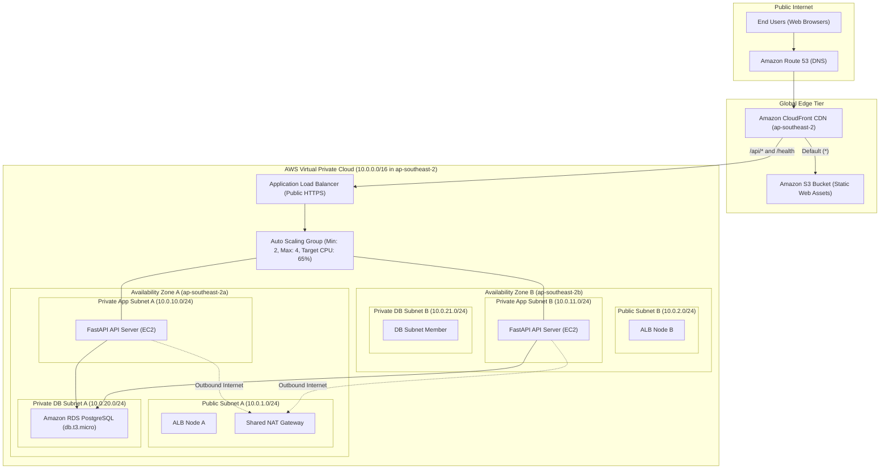
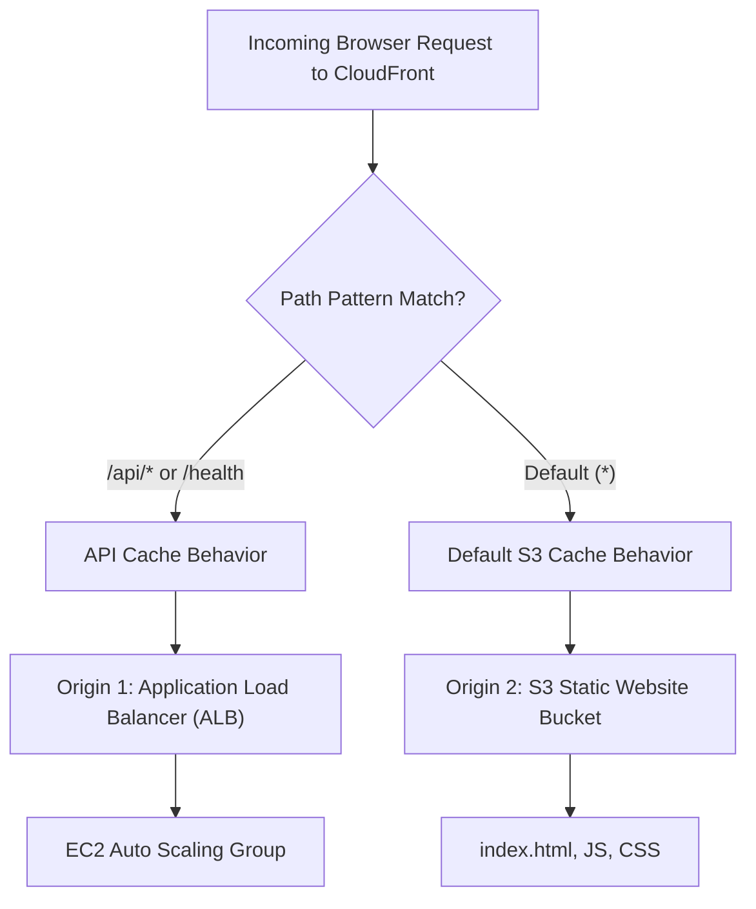
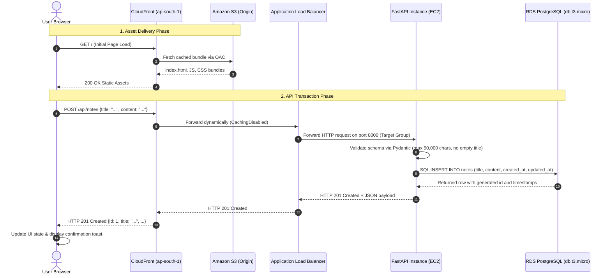
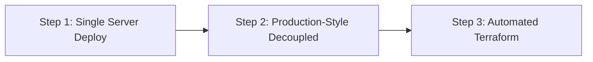

# Cloud Architecture Specification (AWS ap-southeast-2)

## 1. Executive Summary & Learning Budget Architecture

This application follows a cloud-native, decoupled 3-tier architecture deployed on **Amazon Web Services (AWS)** in the **Asia Pacific (Sydney) region (`ap-southeast-2`)** across **two Availability Zones (AZs)** within a dedicated **Virtual Private Cloud (VPC)**.

To accommodate a practical **learning and portfolio budget**, this specification configures cost-efficient resources:
- **Single-AZ RDS PostgreSQL (`db.t3.micro`)** with automated nightly snapshots.
- **Single shared NAT Gateway** deployed in Public Subnet A.
- **Direct ALB ingress** (AWS WAF deferred to future upgrades).
- **Environment-based Secrets delivery** (automated Lambda rotation deferred to future upgrades).

---

## 2. CloudFront Routing Architecture (Dual-Origin Setup)

Amazon CloudFront acts as the single unified entry point for all browser traffic, eliminating Cross-Origin Resource Sharing (CORS) complexity by routing both static frontend assets and dynamic API transactions through the same custom domain:

### 1. Default Cache Behavior (`*`) $\to$ S3 Static Frontend
* **Target Origin:** Private Amazon S3 bucket protected with **Origin Access Control (OAC)**.
* **Viewer Protocol Policy:** `Redirect HTTP to HTTPS`.
* **Allowed HTTP Methods:** `GET, HEAD, OPTIONS`.
* **Cache Policy:** `Managed-CachingOptimized` (TTL default 86,400s; minimizes S3 GET requests).
* **Compression:** Enabled automatically (`Gzip` and `Brotli`).
* **SPA Routing Fallback:** Custom error response configured:
  - HTTP `403 Forbidden` and `404 Not Found` $\to$ Respond with `/index.html` and HTTP `200 OK`. This allows React Router / SPA client-side routing to function without server-side routing files.

### 2. API Cache Behavior (`/api/*`) $\to$ Application Load Balancer
* **Target Origin:** Internet-Facing Application Load Balancer (`ALB`).
* **Path Pattern:** `/api/*`.
* **Viewer Protocol Policy:** `Redirect HTTP to HTTPS`.
* **Allowed HTTP Methods:** `GET, HEAD, OPTIONS, PUT, POST, PATCH, DELETE`.
* **Cache Policy:** `Managed-CachingDisabled` (ensures mutations, searches, and data queries are never served from stale edge caches).
* **Origin Request Policy:** `Managed-AllViewerExceptHostHeader` (preserves client query strings, request headers, and authentication tokens while letting ALB receive the proper Host header).

### 3. Health Probe Cache Behavior (`/health`, `/health/ready`, & `/health/db`) $\to$ Application Load Balancer
* **Target Origin:** Application Load Balancer (`ALB`).
* **Path Pattern:** `/health*`.
* **Viewer Protocol Policy:** `Redirect HTTP to HTTPS`.
* **Allowed HTTP Methods:** `GET, HEAD`.
* **Cache Policy:** `Managed-CachingDisabled` (guarantees external monitoring and health checks reflect instantaneous compute/DB status).
* **Probe Roles:**
  - `GET /health`: Shallow check (HTTP 200, zero DB queries) used for high-frequency ALB target group viability checks.
  - `GET /health/ready`: Readiness check ensuring application is initialized and database connection pool is warmed up before accepting user traffic.
  - `GET /health/db`: Deep check executing `SELECT 1` with latency telemetry in ms for administrative diagnostics.

---

## 3. Request Flow: Creating a Note

The end-to-end operational flow when a user creates a note:

---

## 4. Security Group Chain (Who May Call Whom)

All ingress is governed by strict, least-privilege security group references (referencing Security Group IDs, never open IP CIDRs):

| Security Group | Attached Resource | Ingress Rule | Egress Rule | Purpose |
|---|---|---|---|---|
| **`sg-alb`** | Application Load Balancer | `TCP 443` from `0.0.0.0/0` `TCP 80` from `0.0.0.0/0` (redirect to 443) | `TCP 8000` to `sg-app` | Accepts public internet HTTPS traffic (via CloudFront/Direct); routes only to backend instances. |
| **`sg-app`** | EC2 Instances (Auto Scaling Group) | `TCP 8000` only from `sg-alb` | `TCP 5432` to `sg-db` `TCP 443` to `0.0.0.0/0` (via NAT Gateway) | Only callable by ALB on port 8000. Reaches RDS and fetches OS updates via NAT Gateway. |
| **`sg-db`** | RDS PostgreSQL Instance | `TCP 5432` only from `sg-app` | None (all egress disabled) | Completely unreachable from the internet and ALB; only accessible by backend workers. |

---

## 5. Environments Strategy

| Parameter | Development (Local) | Staging | Production (Learning Budget) |
|---|---|---|---|
| **Region** | Host Machine | `ap-southeast-2` (Sydney) | `ap-southeast-2` (Sydney) |
| **Frontend Origin** | Vite Dev Server (`localhost:5173`) | S3 Bucket + CloudFront Distribution | S3 Bucket + CloudFront Distribution |
| **API Compute** | Host Python Virtual Environment | 1 x `t3.micro` EC2 instance | ASG (2 x `t3.micro`), min: 2, max: 4 |
| **Database** | Docker PostgreSQL 16 container (`localhost:5433`) | RDS PostgreSQL 16 `db.t3.micro` (Single-AZ) | RDS PostgreSQL 16 `db.t3.micro` (Single-AZ) |
| **NAT Egress** | Host Gateway | 1 Shared NAT Gateway (`ap-southeast-2a`) | 1 Shared NAT Gateway (`ap-southeast-2a`) |
| **Secrets Delivery** | `.env` file (Git-ignored) | AWS Systems Manager / Secrets Manager | AWS Secrets Manager (No auto-rotation in MVP) |
| **SSL/TLS** | Plain HTTP | ACM Wildcard Certificate (`*.staging.example.com`) | ACM Wildcard Certificate |
| **Logging Level** | `DEBUG` | `INFO` (CloudWatch Logs) | `INFO` (CloudWatch Logs) |

---

## 6. Phased Deployment Plan

### Step 1: Single Server Deploy (MVP Sanity Check - Verified & Active)
* **Goal:** Prove the application works in a live cloud environment with minimal moving parts.
* **Architecture:** One `t3.micro` EC2 instance in a public subnet running Nginx and FastAPI with local PostgreSQL 16.
* **Live Deployment:** Running on `ap-southeast-2` (Sydney) at `16.176.166.177`.

### Step 2: Production-Style Decoupled Architecture (Manual Console Baseline)
* **Goal:** Implement the full 3-tier production topology in `ap-southeast-2`.
* **Architecture:**
  - S3 + CloudFront dual-origin routing (`/*` $\to$ S3, `/api/*` $\to$ ALB).
  - Dedicated VPC (`notes-vpc`) with 2 Public, 2 Private App, and 2 Private DB subnets across `ap-southeast-2a` and `ap-southeast-2b`.
  - Internet-facing ALB routing to EC2 instances in private subnets.
  - Single-AZ RDS PostgreSQL `db.t3.micro` in private database subnets with connection pool pre-ping and recycle.
  - 1 NAT Gateway in Public Subnet A for backend outbound updates (or cost-saving NAT instance).

### Step 3: Infrastructure as Code with Terraform (Bonus / Automation Step)
* **Goal:** Declare 100% of the infrastructure in version-controlled Terraform modules.

---

## 7. Recalculated Monthly Cost Breakdown (AWS ap-southeast-2 — Learning Budget)

*Estimates based on standard AWS on-demand pricing in Sydney (`ap-southeast-2`):*

| Component | AWS Resource | Specification & Sizing | Est. Monthly Cost (USD) |
|---|---|---|---|
| **Frontend Storage** | Amazon S3 | 5 GB storage, 50,000 GET/PUT requests | \$0.15 |
| **Content Delivery** | Amazon CloudFront | 50 GB transfer out, 1,000,000 HTTPS requests (Covered by Free Tier; standard est.) | \$1.50 |
| **DNS & Routing** | Amazon Route 53 | 1 Hosted Zone + queries | \$0.90 |
| **Load Balancer** | Application Load Balancer | 1 ALB, ~1.5 LCU average usage | \$22.50 |
| **Backend Compute** | EC2 Instances (ASG) | 2 x `t3.micro` (2 vCPU, 1 GB RAM; \$0.0132/hr * 730 * 2) | \$19.27 |
| **Relational Database** | Amazon RDS PostgreSQL | `db.t3.micro` Single-AZ (\$0.021/hr * 730) + 20 GB gp3 storage | \$17.83 |
| **Egress / NAT** | AWS NAT Gateway | 1 NAT Gateway (\$0.048/hr * 730) + 5 GB processed data | \$35.29 |
| **Observability** | Amazon CloudWatch | Basic log ingestion and metric alarms | \$2.50 |
| **Total Estimated Learning Cost** | | | **~\$99.94 / month** |

> [!TIP]
> **Further Cost Optimization Options:**
> - **Replacing NAT Gateway with a NAT Instance (`fck-nat` or `t4g.nano`):** Drops the monthly NAT cost from \$35.29 to **~\$3.50/month**, bringing the total stack down to **~\$68.15/month**.
> - **Zero-NAT Architecture (Stage 1 Default):** Launch without NAT gateway and use Golden AMI or S3 gateway endpoint for dependency staging to keep monthly compute+DB costs under **\$40/month**.
> - **Stopping resources when not actively testing:** Stopping the RDS instance and scaling the ASG to 0 during off-hours reduces the active bill to under **\$25/month**.

---

## 8. Future Improvements & Production Upgrades

To maintain strict cost control during initial development, advanced production features were deferred. When transitioning to full enterprise scale, the following upgrades should be implemented:

1. **Multi-AZ RDS Deployment:**
   - *Upgrade:* Transition from Single-AZ to Multi-AZ standby replica.
   - *Benefit:* Automated zero-data-loss failover within 60–120 seconds if an availability zone suffers an outage.
2. **AWS WAF (Web Application Firewall):**
   - *Upgrade:* Attach AWS WAF to the CloudFront distribution or ALB.
   - *Benefit:* Rate-limiting rules (e.g. 500 requests per 5 minutes per IP) and managed rule sets (OWASP top 10, SQL injection, bots).
3. **Secrets Manager Automated Credential Rotation:**
   - *Upgrade:* Configure AWS Secrets Manager with an automated rotation Lambda function.
   - *Benefit:* Automatically rolls the PostgreSQL master password every 30 days without downtime.
4. **Redundant Multi-AZ NAT Gateways:**
   - *Upgrade:* Deploy a second NAT Gateway in `ap-south-1b`.
   - *Benefit:* Eliminates single-AZ dependency for outbound backend traffic.

---

## 9. Architectural Decision Log

| Decision ID | Choice | One-Line Reason |
|---|---|---|
| **ADR-01** | **FastAPI for Backend API** | Native async performance, Pydantic type validation, and automatic OpenAPI documentation. |
| **ADR-02** | **React + Vite for Frontend** | Compiles into static HTML/JS assets deployable directly to S3/CloudFront with zero Node runtime in production. |
| **ADR-03** | **S3 + CloudFront Dual-Origin Setup** | Unifies frontend assets and backend API under one domain, eliminating CORS friction and maximizing edge caching. |
| **ADR-04** | **Single-AZ RDS `db.t3.micro` for Learning Budget** | Cuts database operational cost by 70% while preserving 100% PostgreSQL 16 engine compatibility. |
| **ADR-05** | **One Shared NAT Gateway in AZ A** | Saves \$33/month over deploying redundant NAT Gateways during the learning phase. |
| **ADR-06** | **Two Dedicated Subnets per AZ (Public, Private App, Private DB)** | Strict network segregation so databases have zero internet route tables. |
| **ADR-07** | **Triple Health Probes (`/health`, `/health/ready`, `/health/db`)** | Shallow check keeps ALB fast; readiness check gates ASG lifecycle; deep check monitors DB viability. |
| **ADR-08** | **Security Group Chaining over IP CIDRs** | Eliminates fragile hardcoded IP addresses and guarantees only authenticated ALB traffic reaches compute. |
| **ADR-09** | **SQLAlchemy QueuePool with Pre-Ping & 1800s Recycle** | Prevents stale connection drops behind AWS VPC NAT and firewalls during idle periods. |
| **ADR-10** | **Discrete Database Environment Parameters with URL Encoding** | Allows separate host, user, password, and port injection via SSM without parsing brittle raw connection strings. |
