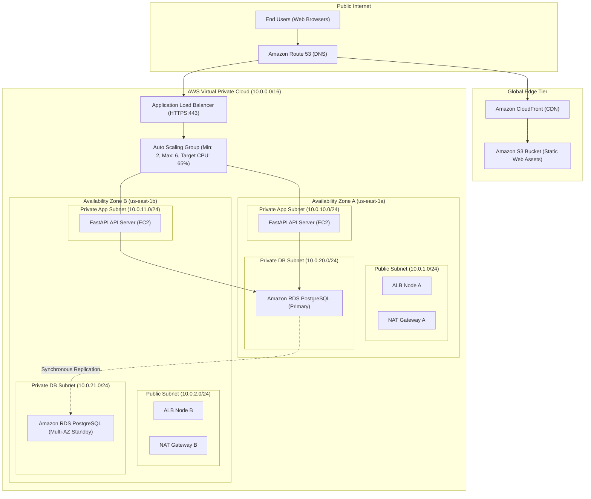
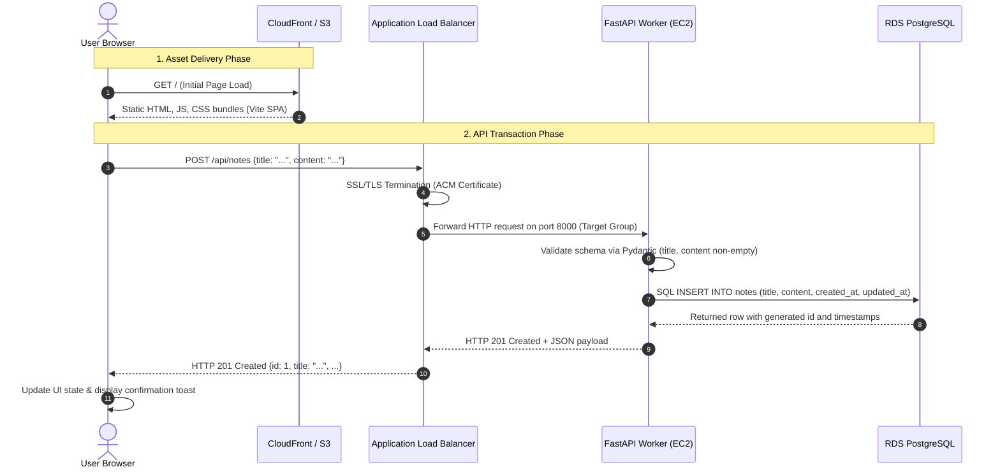
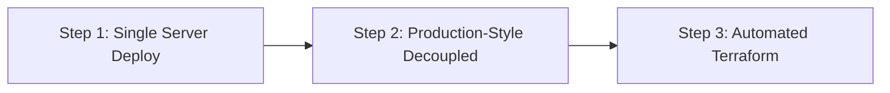

# Cloud Architecture Specification

## 1. Executive Summary & Target Architecture

This application follows a cloud-native, decoupled 3-tier architecture deployed on **Amazon Web Services (AWS)** across **two Availability Zones (AZs)** within a dedicated **Virtual Private Cloud (VPC)**.

---

## 2. Request Flow: Creating a Note

The end-to-end operational flow when a user creates a note:

1. **Frontend Asset Request:** The browser resolves the custom domain via Route 53. CloudFront serves cached static assets (`index.html`, JavaScript, CSS) from edge caches, backed by the origin S3 bucket.
2. **API Dispatch:** User fills the "New Note" modal and clicks "Save Note". The SPA issues a `POST /api/notes` request to `https://api.example.com/api/notes`.
3. **Traffic Ingestion & TLS Termination:** The internet-facing Application Load Balancer terminates TLS (using an AWS Certificate Manager certificate) and evaluates listener routing rules.
4. **Backend Target Routing:** The ALB routes the request across healthy EC2 targets in private subnets over internal port 8000.
5. **Validation & Business Logic:** FastAPI unpacks the payload, validates types and lengths via Pydantic `NoteCreate`, and acquires an active DB connection from the SQLAlchemy connection pool.
6. **Data Persistence:** The worker executes an `INSERT` statement against the primary RDS PostgreSQL instance in the private database subnet.
7. **Replication & Response:** PostgreSQL records the transaction into the Write-Ahead Log (WAL), synchronously replicates to the Multi-AZ standby, and returns the committed record. FastAPI yields `201 Created` back to the ALB and user browser.

---

## 3. Security Group Chain (Who May Call Whom)

All ingress is governed by strict, least-privilege security group references (referencing Security Group IDs, never open IP CIDRs):

| Security Group | Attached Resource | Ingress Rule | Egress Rule | Purpose |
|---|---|---|---|---|
| **`sg-alb`** | Application Load Balancer | `TCP 443` from `0.0.0.0/0` `TCP 80` from `0.0.0.0/0` (redirect to 443) | `TCP 8000` to `sg-app` | Accepts public internet HTTPS traffic; routes only to backend instances. |
| **`sg-app`** | EC2 Instances (Auto Scaling Group) | `TCP 8000` only from `sg-alb` | `TCP 5432` to `sg-db` `TCP 443` to `0.0.0.0/0` (via NAT Gateway) | Only callable by ALB on port 8000. Reaches RDS and fetches OS updates via NAT. |
| **`sg-db`** | RDS PostgreSQL Instance | `TCP 5432` only from `sg-app` | None (all egress disabled) | Completely unreachable from the internet and ALB; only accessible by backend workers. |
| **`sg-endpoints`** | VPC Interface Endpoints (SSM, Secrets) | `TCP 443` from `sg-app` | None | Secure private connectivity to AWS Systems Manager & Secrets Manager without internet transit. |

---

## 4. Environments Strategy

| Parameter | Development (Local) | Staging | Production |
|---|---|---|---|
| **Frontend Origin** | Vite Dev Server (`localhost:5173`) | S3 Bucket + CloudFront Staging Distribution | S3 Bucket + Multi-Edge CloudFront Distribution |
| **API Compute** | Host Python Virtual Environment | 2 x `t4g.small` EC2 instances (Multi-AZ) | ASG (`t4g.medium` or `c7g.large`), min: 2, max: 6 |
| **Database** | Docker PostgreSQL 16 container (`localhost:5433`) | RDS PostgreSQL 16 `db.t4g.micro` (Single-AZ) | RDS PostgreSQL 16 `db.t4g.small` (Multi-AZ Standby) |
| **Secrets Delivery** | `.env` file (Git-ignored) | AWS Secrets Manager / Parameter Store | AWS Secrets Manager (Auto-rotated credentials) |
| **SSL/TLS** | Plain HTTP | ACM Wildcard Certificate (`*.staging.example.com`) | ACM Wildcard Certificate (`api.example.com`, `example.com`) |
| **Logging Level** | `DEBUG` | `INFO` (JSON formatted to CloudWatch) | `INFO` / `WARN` (CloudWatch Logs + metric filters) |

---

## 5. Phased Deployment Plan

To prevent architectural debt and premature complexity, deployment proceeds in three distinct milestones:

### Step 1: Single Server Deploy (MVP Sanity Check)
* **Goal:** Prove the application works in a live cloud environment with minimal moving parts.
* **Architecture:**
  - One `t4g.small` EC2 instance in a public subnet running both Nginx (reverse proxy & static frontend hosting) and FastAPI (via Systemd or Docker).
  - PostgreSQL running locally on the instance or attached via lightweight single-AZ RDS.
* **Outcome:** Validates firewall rules, DNS propagation, and application runtime on Amazon Linux / Ubuntu.

### Step 2: Production-Style Decoupled Architecture (Manual Console / CLI Baseline)
* **Goal:** Implement the full 3-tier production topology.
* **Architecture:**
  - Frontend compiled with `npm run build` and synced to S3 origin bucket behind CloudFront.
  - Dedicated VPC with 2 Public, 2 Private App, and 2 Private DB subnets across 2 AZs.
  - Internet-facing ALB in public subnets routing to EC2 instances in private subnets.
  - Managed RDS PostgreSQL (Multi-AZ) deployed to private database subnets.
  - NAT Gateways provisioned in public subnets for backend outbound internet access (package updates).
* **Outcome:** Validates network isolation, security group chaining, and health probe viability under high availability.

### Step 3: Infrastructure as Code with Terraform (Bonus / Enterprise Step)
* **Goal:** Declare 100% of the infrastructure in version-controlled Terraform modules.
* **Architecture:**
  - Modules for `vpc`, `security_groups`, `s3_frontend`, `alb`, `asg`, and `rds`.
  - Remote state stored in encrypted S3 bucket with DynamoDB state locking.
  - Parameterized environment workspaces (`staging`, `prod`).
  - GitHub Actions CI/CD pipeline running `terraform plan` on PR and automated rolling deployments.
* **Outcome:** Entire infrastructure reproducible and disposable with a single automated execution.

---

## 6. Estimated Monthly Cost Breakdown (AWS us-east-1)

*Estimates based on standard AWS on-demand pricing in `us-east-1` (US N. Virginia):*

| Component | AWS Resource | Specification & Sizing | Est. Monthly Cost (USD) |
|---|---|---|---|
| **Frontend Storage** | Amazon S3 | 5 GB storage, 50,000 PUT/GET requests | \$0.20 |
| **Content Delivery** | Amazon CloudFront | 50 GB transfer out, 1,000,000 HTTPS requests | \$4.85 |
| **Load Balancer** | Application Load Balancer | 1 ALB, ~2 LCU average usage | \$22.50 |
| **Backend Compute** | EC2 Instances (ASG) | 2 x `t4g.small` (ARM Graviton2, 2 vCPU, 2 GB RAM) | \$24.50 |
| **Relational Database** | Amazon RDS PostgreSQL | `db.t4g.small` Multi-AZ, 20 GB gp3 storage | \$51.20 |
| **Egress / NAT** | AWS NAT Gateway | 1 NAT Gateway (shared) + 15 GB processed data | \$33.60 |
| **DNS & Routing** | Amazon Route 53 | 1 Hosted Zone + 1,000,000 DNS queries | \$0.90 |
| **Observability** | Amazon CloudWatch | 5 GB logs ingested, basic alarms, metrics | \$4.50 |
| **Total Estimated Cost** | | | **~\$142.25 / month** |

> [!TIP]
> **Cost Optimization for Staging/Dev:**
> - Switching RDS from Multi-AZ to Single-AZ saves ~\$25/month.
> - Replacing the managed NAT Gateway with an EC2 NAT instance (`fck-nat` or `t4g.nano`) saves ~\$30/month.
> - Using AWS Free Tier on new accounts covers CloudFront (1 TB free) and S3 (5 GB free).

---

## 7. Architectural Decision Log

| Decision ID | Choice | One-Line Reason |
|---|---|---|
| **ADR-01** | **FastAPI for Backend API** | Native async performance, Pydantic type validation, and automatic OpenAPI documentation. |
| **ADR-02** | **React + Vite for Frontend** | Compiles into static HTML/JS assets deployable directly to S3/CloudFront with zero Node runtime in production. |
| **ADR-03** | **S3 + CloudFront over EC2 Web Serving** | Unlimited scalability, global edge caching, and 90% lower operational cost than running web servers. |
| **ADR-04** | **PostgreSQL on Amazon RDS** | ACID compliance, automatic daily backups, automated minor version patching, and turnkey Multi-AZ failover. |
| **ADR-05** | **Two Dedicated Subnets per AZ (Public, Private App, Private DB)** | Strict network segregation so databases have zero internet route tables. |
| **ADR-06** | **Dual Health Probes (`/health` vs `/health/db`)** | Shallow check keeps ALB fast and independent of DB spikes; deep check monitors DB viability. |
| **ADR-07** | **Security Group Chaining over IP CIDRs** | Eliminates fragile hardcoded IP addresses and guarantees only authenticated ALB traffic reaches compute. |
| **ADR-08** | **AWS Graviton (`t4g`) Compute Instances** | 20% better price-to-performance ratio over standard x86 (`t3`) instances on AWS. |

