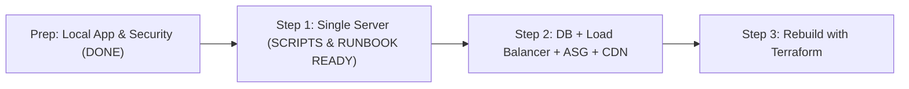

# Project Execution Phases & Roadmap

**Project Name:** Professional-Level Cloud Web Application (Cloud Notes)  
**Version:** 2.0.0  
**Status:** Approved Roadmap  
**Target Cloud:** Amazon Web Services (`ap-south-1`)  

---

## 🗺️ Roadmap Overview

Following the core architectural rule **"Don't build it all at once"**, the project progresses through three distinct cloud deployment steps after local preparation:

---

## Detailed Phases

### Prep: Local Application, Test Harness & Security Hardening
* **Status:** **DONE**
* **Objective:** Build, test, and harden the full-stack application locally before touching cloud resources.
* **Accomplishments:**
  - **Local Application Architecture:** FastAPI stateless backend with decoupled health probes (`/health` and `/health/db`), SQLAlchemy models, Pydantic v2 schemas, and full CRUD endpoints (`/api/notes`).
  - **Static Frontend:** React + Vite Single Page Application with responsive note grid, modal create/edit, real-time search, and live health status badges.
  - **Local Infrastructure:** Docker Compose PostgreSQL 16 Alpine container mapped to loopback port `127.0.0.1:5433:5432`.
  - **Automated Test Suites:** 11 backend `pytest` tests (in-memory SQLite isolation) and 2 frontend `node:test` unit tests passing with zero failures. Static bundle verified compiling cleanly into `dist/` via `npm run build`.
  - **Security Remediation:** Resolved all 7 audit vulnerabilities from [docs/SECURITY.md](file:///e:/PROJECTS/Professional-Level%20Cloud%20Web%20Application/docs/SECURITY.md) (safe generic errors, 50k char content limit, 100 char search query limit, strict CORS with no wildcard default, zero hardcoded secrets, loopback port binding, and defensive security headers).
  - **Foundational Documentation:** Created [docs/PRD.md](file:///e:/PROJECTS/Professional-Level%20Cloud%20Web%20Application/docs/PRD.md), [docs/RULES.md](file:///e:/PROJECTS/Professional-Level%20Cloud%20Web%20Application/docs/RULES.md), [docs/DESIGN.md](file:///e:/PROJECTS/Professional-Level%20Cloud%20Web%20Application/docs/DESIGN.md), [docs/ARCHITECTURE.md](file:///e:/PROJECTS/Professional-Level%20Cloud%20Web%20Application/docs/ARCHITECTURE.md), [docs/DATABASE.md](file:///e:/PROJECTS/Professional-Level%20Cloud%20Web%20Application/docs/DATABASE.md), [docs/SECURITY.md](file:///e:/PROJECTS/Professional-Level%20Cloud%20Web%20Application/docs/SECURITY.md), [docs/TESTING.md](file:///e:/PROJECTS/Professional-Level%20Cloud%20Web%20Application/docs/TESTING.md), and [deploy/user-data.sh](file:///e:/PROJECTS/Professional-Level%20Cloud%20Web%20Application/deploy/user-data.sh).

---

### Step 1: Single Server Deploy (One Server, App Live)
* **Status:** **DEPLOYMENT PACKAGE & RUNBOOK READY**
* **Objective:** Deploy the working application to a single virtual server to prove compute runtime, packaging, firewall rules, and DNS resolution in the live cloud with minimal moving parts.
* **Accomplishments & Deliverables:**
  - **Frontend Relative URLs:** Configured `/api/...` and health endpoints in `frontend/src/api.js` to work seamlessly behind Nginx on the same host while preserving local Vite dev server proxying.
  - **Server Setup Automation:** Implemented `deploy/step1/setup-server.sh` on Amazon Linux 2023 with Python 3.11, Nginx, PostgreSQL 16/15, secure database user creation, Alembic migration execution, 0600 `.env` generation, and verification probes.
  - **Templates:** Created `deploy/step1/nginx.conf` (SPA routing fallback, security headers, reverse proxy) and `deploy/step1/api.service` (systemd daemon with auto-restart).
  - **Packaging Automation:** Implemented `deploy/step1/build-and-package.ps1` for Windows PowerShell, generating a pristine `deploy.zip` (~67 KB) excluding secrets, venv, and node_modules.
  - **Operational Runbook:** Published [docs/STEP1_RUNBOOK.md](file:///e:/PROJECTS/Professional-Level%20Cloud%20Web%20Application/docs/STEP1_RUNBOOK.md) with exact AWS Console steps, SSH lockdown, verification steps, troubleshooting commands, and reverse-order teardown.

---

### Step 2: Database + Load Balancer + Auto Scaling + CDN (Production-Style Decoupled)
* **Status:** **NOT STARTED (Console Runbook Ready)**
* **Objective:** Expand the application into a full 3-tier high-availability architecture following [docs/STEP2_RUNBOOK.md](file:///e:/PROJECTS/Professional-Level%20Cloud%20Web%20Application/docs/STEP2_RUNBOOK.md).
* **Architecture:**
  - `Users` $\to$ `CloudFront CDN` $\to$ `S3 Frontend` (Static assets)
  - `Users` $\to$ `CloudFront CDN` $\to$ `ALB` $\to$ `Auto Scaling Group (EC2)` $\to$ `RDS PostgreSQL` (VPC private subnets)
  - **Networking:** Dedicated VPC (`10.0.0.0/16`) across 2 AZs (`ap-south-1a`, `ap-south-1b`) with 2 public subnets, 2 private app subnets, 2 private DB subnets, Internet Gateway, and 1 shared NAT Gateway.
  - **Security Groups:** Least-privilege chain (`sg-alb` $\to$ `sg-app` $\to$ `sg-db`).
  - **Database:** Managed Amazon RDS PostgreSQL 16 (`db.t3.micro`, Single-AZ learning budget, private subnets, `PubliclyAccessible = false`).
  - **Compute & Scaling:** EC2 Launch Template using [deploy/user-data.sh](file:///e:/PROJECTS/Professional-Level%20Cloud%20Web%20Application/deploy/user-data.sh) with dynamic SSM credentials; Auto Scaling Group (min 2, max 4) with CPU Target Tracking at 65%.
  - **Edge & Routing:** Private S3 bucket with Origin Access Control (OAC); dual-origin CloudFront distribution (`*` $\to$ S3, `/api/*` and `/health` $\to$ ALB).
* **Validation Criteria (Three Chaos Proofs from [docs/TESTING.md](file:///e:/PROJECTS/Professional-Level%20Cloud%20Web%20Application/docs/TESTING.md)):**
  1. *Proof 1:* Terminating an EC2 instance in ASG results in zero downtime for users.
  2. *Proof 2:* Sustained load test triggers ASG scale-out from 2 to 4 instances.
  3. *Proof 3:* Direct external TCP/nmap connection to private RDS database times out completely.

---

### Step 3: Rebuild with Terraform (Everything as Code, One Command)
* **Status:** **NOT STARTED (Planned Bonus Step)**
* **Objective:** Codify 100% of the verified Step 2 production architecture into modular, version-controlled Infrastructure as Code (IaC).
* **Architecture:**
  - Root module + reusable child modules (`vpc`, `security_groups`, `rds`, `alb`, `asg`, `s3_frontend`, `cloudfront`).
  - Remote state management: S3 bucket with server-side encryption and DynamoDB state locking.
  - Single command execution: `terraform apply` / `terraform destroy` to spin up or tear down the entire stack.
  - Automated CI/CD pipeline with GitHub Actions running `terraform plan` on pull requests.

---

## 🚦 Phase Transition Checklist

| Transition | Prerequisite Gates | Verification Method |
|---|---|---|
| **Prep $\to$ Step 1** | Local app operational, all tests passing, security audit remediated. | `pytest -v` (11/11 pass), `npm test` (2/2 pass), `npm run build` pass. |
| **Step 1 $\to$ Step 2** | Single-server EC2 live, public DNS responding, CRUD working. | Browser inspection of live single server. |
| **Step 2 $\to$ Step 3** | All AWS resources provisioned per runbook; 3 chaos proofs pass. | CloudWatch alarms, ALB health metrics, nmap timeout logs. |
