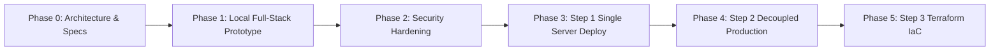

# Project Execution Phases & Roadmap

**Project Name:** Professional-Level Cloud Web Application (Cloud Notes)  
**Version:** 1.0.0  
**Status:** Approved Roadmap  
**Target Cloud:** Amazon Web Services (`ap-south-1`)  

---

## 🗺️ Roadmap Overview

To prevent premature architectural complexity and ensure robust verification at every layer, the project follows a disciplined 6-phase engineering lifecycle:

---

## Detailed Phase Breakdown

### Phase 0: Requirements, Architecture & Design Specifications
* **Status:** **Completed**
* **Primary Objective:** Establish the architectural blueprints, data models, threat models, and engineering constraints before writing code.
* **Key Deliverables:**
  - `PRD.md`: Functional and non-functional requirements.
  - `ARCHITECTURE.md`: Target cloud topology, request flows, dual-origin CloudFront routing, and `ap-south-1` cost estimates.
  - `DATABASE.md`: PostgreSQL schema, query-specific indexes, PITR recovery, and credential delivery plans.
  - `SECURITY.md`: Data classification, network boundaries, OWASP Top 10 pre-merge checklist, and initial audit.
  - `TESTING.md`: Test pyramid, execution commands, and three chaos infrastructure proofs.
  - `DESIGN.md`: Visual tokens, typography, component geometry, and UI state patterns.
  - `AGENTS.md`: AI agent guidelines, strict rules, and 5-step development workflow.

---

### Phase 1: Local Full-Stack Prototype & Test Harness
* **Status:** **Completed**
* **Primary Objective:** Deliver a working, fully decoupled local application meeting all PRD criteria.
* **Key Deliverables:**
  - `docker-compose.yml`: PostgreSQL 16 Alpine container running on port `5433` (loopback mapped).
  - `backend/`: FastAPI REST API with SQLAlchemy models, Pydantic schemas, and CRUD routes (`/api/notes`).
  - Strict health probe decoupling: `GET /health` (shallow ALB probe) and `GET /health/db` (deep PostgreSQL probe).
  - `frontend/`: React + Vite SPA with responsive card grid, modal form, real-time search, and live health status badges.
  - `frontend/dist/`: Static bundle verified compiling cleanly for future S3 deployment (`npm run build`).
  - Automated test suites: `pytest` backend tests and `node:test` frontend tests passing with zero failures.

---

### Phase 2: Security Hardening & Audit Remediation
* **Status:** **Completed**
* **Primary Objective:** Address all 7 vulnerabilities identified during the `SECURITY.md` audit.
* **Key Deliverables:**
  - **Error Disclosure Fix:** Replaced `str(exc)` in `/health/db` with a generic message; raw exceptions logged server-side.
  - **Input Boundaries:** Added `max_length=50000` on note content and `max_length=100` on search queries.
  - **CORS Hardening:** Removed wildcard defaults; origins loaded from `CORS_ORIGINS` environment variable.
  - **Credential Isolation:** Removed hardcoded fallback passwords from `config.py`; `docker-compose.yml` bound strictly to `127.0.0.1`.
  - **Security Headers Middleware:** Added `X-Content-Type-Options: nosniff`, `X-Frame-Options: DENY`, `X-XSS-Protection`, `Referrer-Policy`, and `HSTS`.
  - **Regression Testing:** Expanded test suite to 11 passing backend tests and 2 passing frontend tests.

---

### Phase 3: Step 1 Single-Server EC2 Cloud Deployment (MVP Sanity Check)
* **Status:** **Ready for Execution**
* **Primary Objective:** Verify compute, DNS, and application packaging on a live AWS instance with minimal moving parts.
* **Architecture:**
  - 1 x `t3.micro` EC2 instance in a public subnet in `ap-south-1`.
  - Single security group allowing HTTP (port 80) and HTTPS (port 443).
  - Nginx reverse-proxying requests to local FastAPI process (systemd service).
* **Validation Criteria:**
  - Public DNS resolves to instance.
  - CRUD operations succeed against local database on the instance.
  - Validates Amazon Linux 2023 OS packages and systemd unit configuration.

---

### Phase 4: Step 2 Decoupled Production-Style Deployment
* **Status:** **Console Runbook Ready (`docs/STEP2_RUNBOOK.md`)**
* **Primary Objective:** Build the complete 3-tier decoupled production architecture in the AWS Console (`ap-south-1`).
* **Architecture:**
  - **Networking:** Dedicated VPC (`10.0.0.0/16`) with 2 public subnets, 2 private app subnets, 2 private DB subnets, Internet Gateway, 1 NAT Gateway, and segregated route tables.
  - **Security Groups:** Chained `sg-alb` $\to$ `sg-app` $\to$ `sg-db`.
  - **Database:** Amazon RDS PostgreSQL 16 (`db.t3.micro`, Single-AZ, private DB subnet group, `PubliclyAccessible = false`).
  - **Secrets:** Database URL saved securely in AWS SSM Parameter Store (`/notes-app/DATABASE_URL`).
  - **Compute:** Launch Template with `deploy/user-data.sh` (zero hardcoded secrets).
  - **Load Balancing:** Target group on port 8000 (`/health`), public Application Load Balancer.
  - **Auto Scaling:** Auto Scaling Group (min 2, max 4, desired 2) with CPU Target Tracking at 65%.
  - **Edge & Storage:** Private S3 bucket with Origin Access Control (OAC) and dual-origin CloudFront distribution (`*` $\to$ S3, `/api/*` and `/health` $\to$ ALB).
* **Verification Proofs (from `docs/TESTING.md`):**
  1. *Proof 1:* Terminating an EC2 instance in ASG maintains 100% application uptime.
  2. *Proof 2:* Sustained load test triggers ASG scale-out from 2 to 4 instances.
  3. *Proof 3:* Direct external TCP/nmap connection to RDS endpoint times out completely.

---

### Phase 5: Step 3 Infrastructure as Code (IaC) with Terraform (Bonus Step)
* **Status:** **Planned / Future Milestone**
* **Primary Objective:** Automate 100% of the Phase 4 infrastructure in reproducible, version-controlled Terraform code.
* **Architecture:**
  - Root module + child modules (`vpc`, `security_groups`, `rds`, `alb`, `asg`, `s3_frontend`, `cloudfront`).
  - Remote state management: S3 bucket with server-side encryption and DynamoDB state locking.
  - Multi-environment workspaces (`staging`, `prod`).
  - GitHub Actions CI/CD: Automated `terraform plan` on pull requests and rolling deployments on merge.

---

## 🚦 Phase Gate Checklist

Before advancing to any subsequent phase, the following gate criteria must be satisfied:

| Phase Transition | Required Gates | Verification Method |
|---|---|---|
| **Phase 1 $\to$ Phase 2** | Local API functional, tests passing, `/health` decoupled. | `pytest -v` and `npm test` exit with code 0. |
| **Phase 2 $\to$ Phase 3** | All 7 security vulnerabilities fixed, input limits active. | Security review verified in `SECURITY.md`. |
| **Phase 3 $\to$ Phase 4** | EC2 user-data script tested, systemd service operational. | `deploy/user-data.sh` boots API cleanly. |
| **Phase 4 $\to$ Phase 5** | All 3 infrastructure proofs pass; monthly bill under budget. | CloudWatch metrics and test evidence logged. |
