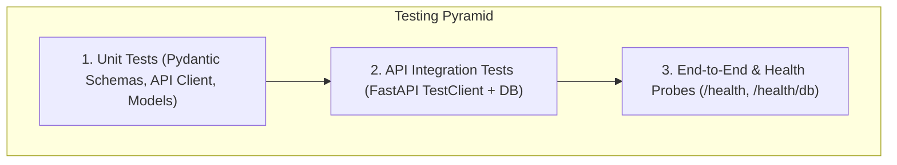

# Testing Strategy & Verification Guide

## 1. Overview & Test Layers

Testing follows the standard test pyramid, validating software behavior across **three primary layers**:
1. **Backend Layer (API & Data Persistence):** Unit and integration testing of endpoints, database interactions, Pydantic validations, and error responses.
2. **Frontend Layer (UI & Client Integration):** Validation of client API request construction, response parsing, and state updates.
3. **API & Health Check Layer (ALB & Infrastructure Probes):** Live verification of shallow ALB viability and deep database connectivity.



---

## 2. Test Tools & Execution Commands

### 2.1 Backend Testing Layer
* **Tool:** `pytest` with `fastapi.testclient.TestClient` and in-memory SQLite / test database.
* **Commands:**
  ```powershell
  # Navigate to backend directory
  cd backend

  # Activate virtual environment
  .\venv\Scripts\Activate.ps1

  # Run full test suite with verbose output
  pytest -v

  # Run test suite with code coverage report
  pytest --cov=app tests/
  ```

### 2.2 Frontend Testing Layer
* **Tool:** Node.js built-in native test runner (`node:test` & `node:assert`) and static build verification (`vite build`).
* **Commands:**
  ```powershell
  # Navigate to frontend directory
  cd frontend

  # Run native unit tests
  npm test

  # Run production static bundle compilation test
  npm run build
  ```

### 2.3 Live API Health Check Probes
* **Tool:** `curl` or PowerShell `Invoke-RestMethod`.
* **Commands:**
  ```powershell
  # 1. Shallow health probe (Application Load Balancer viability)
  curl http://localhost:8000/health
  # Expected: {"status":"healthy","service":"notes-api","timestamp":"..."} (HTTP 200)

  # 2. Deep database connectivity probe
  curl http://localhost:8000/health/db
  # Expected: {"status":"healthy","database":"connected","timestamp":"..."} (HTTP 200)
  ```

---

## 3. Critical Infrastructure Proofs (Chaos & Resilience Checks)

To guarantee that the production cloud deployment satisfies enterprise standards, the following three infrastructure proofs must be validated:

### Proof 1: Instance Termination Keeps the App Up (High Availability & Self-Healing)
* **Objective:** Prove that terminating an EC2 instance in the Auto Scaling Group causes zero downtime or failed requests for end users.
* **Execution Procedure:**
  1. Initiate continuous synthetic traffic against the Application Load Balancer:
     ```bash
     while true; do curl -s -o /dev/null -w "%{http_code}\n" https://api.example.com/health; sleep 0.2; done
     ```
  2. Terminate an active EC2 instance in Availability Zone A via AWS CLI:
     ```bash
     aws ec2 terminate-instances --instance-ids <target_instance_id>
     ```
* **Success Criteria:**
  - The ALB health check detects the failing instance within 10 seconds (2 consecutive failed checks of 5s interval).
  - The ALB deregisters the target, seamlessly directing 100% of incoming traffic to the surviving instance in AZ B.
  - Zero `502 Bad Gateway` or `504 Gateway Timeout` errors recorded in the synthetic traffic monitor.
  - The Auto Scaling Group launches a healthy replacement instance and attaches it to the Target Group within ~90 seconds.

---

### Proof 2: Load Test Triggers Elastic Auto Scaling
* **Objective:** Prove that synthetic traffic spikes trigger the Auto Scaling Group policy to dynamically scale compute instances out and in.
* **Execution Procedure:**
  1. Run a sustained load test against the API using `k6` or `Apache Bench`:
     ```bash
     # Send 150 concurrent requests for 5 minutes
     ab -n 100000 -c 150 https://api.example.com/api/notes
     ```
  2. Monitor the CloudWatch Alarm: `TargetTracking-ASG-CPU-High` (Target metric: Average CPU Utilization > 65%).
* **Success Criteria:**
  - As CPU utilization breaches 65% for 3 consecutive periods, CloudWatch triggers the scale-out policy.
  - ASG desired capacity increases from 2 instances to 4 instances.
  - New instances initialize, pass the `/health` check on port 8000, and enter the `InService` state.
  - Once the load test concludes, the cooldown timer triggers a scale-in back to the baseline minimum of 2 instances.

---

### Proof 3: Database is Unreachable from the Public Internet (Zero Direct Exposure)
* **Objective:** Cryptographically and network-wise verify that the RDS PostgreSQL instance cannot be reached from outside the private VPC.
* **Execution Procedure:**
  1. Obtain the RDS endpoint hostname: `notes-db-prod.c123456789.us-east-1.rds.amazonaws.com`.
  2. From an external machine on the public internet, attempt a direct TCP connection on PostgreSQL port 5432:
     ```bash
     nc -zv -w 5 notes-db-prod.c123456789.us-east-1.rds.amazonaws.com 5432
     ```
  3. Attempt an `nmap` port scan:
     ```bash
     nmap -Pn -p 5432 notes-db-prod.c123456789.us-east-1.rds.amazonaws.com
     ```
* **Success Criteria:**
  - Network probe times out completely (packet dropped by Security Group `sg-db`).
  - No TCP handshake (`SYN-ACK`) is returned.
  - `nmap` reports port 5432 as `filtered`.
  - Proves that `PubliclyAccessible = false` and `sg-db` ingress restricts access strictly to `sg-app`.

---

## 4. Definition-of-Done (DoD) Checklist

A feature, branch, or release is deemed **Done** and ready for production promotion only when all criteria below are verified:

- [ ] **Functional Integrity:** All CRUD operations (Create, List, Read, Update, Delete) operate cleanly with HTTP 200/201/204 response codes.
- [ ] **Shallow Health Probe Independence:** `GET /health` responds with HTTP 200 in $< 10\text{ ms}$ without querying or locking the database.
- [ ] **Deep Health Probe Verification:** `GET /health/db` executes `SELECT 1` and returns HTTP 200 when database connectivity is sound.
- [ ] **Schema & Validation:** Invalid or malformed requests (e.g. empty strings, null values, type mismatches) are rejected with HTTP 422 Unprocessable Entity.
- [ ] **Automated Test Coverage:**
  - 100% of backend unit and integration tests pass via `pytest`.
  - 100% of frontend tests pass via `npm test`.
  - Frontend static build succeeds via `npm run build` with zero compiler warnings.
- [ ] **Security Compliance:**
  - Zero hardcoded secrets, database passwords, or private keys committed to Git.
  - `.env` file is excluded via `.gitignore`.
  - CORS policy is configured with explicit origins.
  - `pip-audit` and `npm audit` report zero High/Critical vulnerabilities.
- [ ] **Cloud Readiness:**
  - Frontend compiles to pure static assets suitable for Amazon S3 origin hosting.
  - Backend runs as a stateless process capable of running in an Auto Scaling Group behind an Application Load Balancer.

